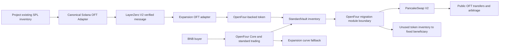

# Architecture and responsibility boundaries

| Party | Owns and maintains | Explicit exclusions / trust |
|---|---|---|
| Expansion protocol | Solana program deployment and Adapter store; source admission evidence; registry; LayerZero peers/DVNs/options; escrow/supply monitoring; price and eligibility signer; bootstrap orchestration; bridge lifecycle; deployment/tests | Is a bridge operator; cannot delegate these responsibilities to Four.Meme merely by saying LayerZero |
| Four.Meme/OpenFour | Core, Registry, orchestration, discovery/UI, quote/trade execution, fees, standard vault, module/Preset review and official registration, supported migration/LP policy | Does not operate Solana custody or source oracle. Core authority over StandardVault remains a trusted platform boundary |
| Project | Chooses compatible mint; provides inventory; pays transaction/messaging costs or uses sponsored operations; accepts immutable launch settings | No BNB LP deposit, no mint role, no right to accumulated user BNB. Fixed beneficiary receives unused token inventory only after successful migration |
| Users | Buy/sell/transfer during launch; DEX trade after migration; OFT bridge after both directions enabled | No receipt token; source price can diverge during the closed-bridge period; no guaranteed redemption at launch price |
| Oracle signer | Confirms source-market price, capitalization and age at activation | Trusted MVP signer; cannot mint; can misprice or deny activation |
| Source registrar | Confirms canonical program/store/mint/custody and publishes evidence hash | Trusted admission; can admit a bad new asset if compromised; cannot rewrite enrolled mapping |
| Endpoint delegate / Solana governance | Configuration, pause and upgrade authorities | Can censor, change verification security or (if source upgradeable) compromise backing. Independent multisig/timelock procedures needed |

Four.Meme can build the bridge itself, but then takes on source-chain custody, RPC/indexing, mint compatibility, LayerZero configuration, signer operations, incident response and continuous supply reconciliation. This protocol packages those obligations behind token, pricing and migration interfaces it can review. The differentiation is operational responsibility and reusable source adapters, not an artificial exclusive token standard.

The reference does not change Core or add a competing trading UI. It creates only the missing backed-token behavior and conservative public-interface fallbacks. Other destinations can reuse the canonical OFT/source operations with different launch adapters. New source chains must preserve normalized backing and packet authentication, not just reuse a ticker.
